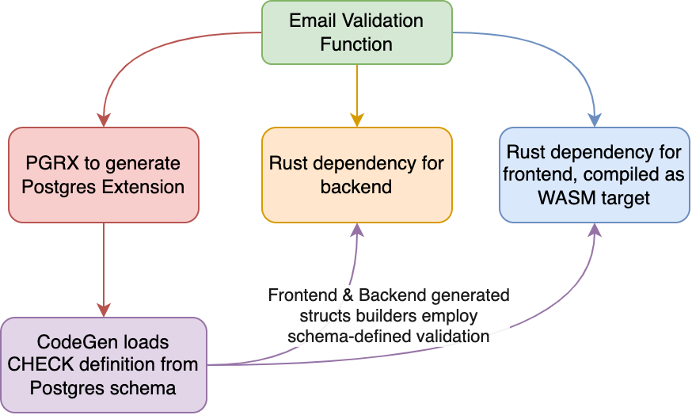

# PGRX Validation

Validation functions written once in Rust and used both as an ordinary Rust dependency and, through [`pgrx`](https://github.com/pgcentralfoundation/pgrx), as PostgreSQL functions that `CHECK` constraints call.

- [`pgrx_validation`](pgrx_validation) holds the validations, among them `must_be_email`, `must_be_paragraph` and `must_be_font_awesome_class`. Without features it is a plain library returning `Result<(), pgrx_validation::Error>`. With the `pgrx` feature and one of `pg13` to `pg17` it builds the `pgrx_validation` PostgreSQL extension, where each function returns `true` or raises an error.
- [`pgrx_validation_derive`](pgrx_validation_derive) provides the `#[validation]` attribute that enforces the naming and signature rules and generates the PostgreSQL wrapper.

See [CONTRIB.md](CONTRIB.md) to build and test the extension.
